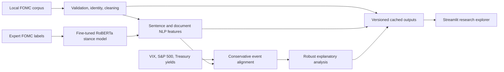

# FOMC Stock Market Volatility Analysis

This repository is a completed, reproducible observational research system for
Federal Reserve policy communication and cross-market reactions. It combines validated
document processing, expert-supervised policy-stance measurement, conservative event
alignment, robust explanatory statistics, and a cached-output Streamlit explorer.

## Problem statements

1. **Reliable policy-signal extraction:** How can we build a reproducible NLP pipeline that preserves distinct Federal Reserve documents and reliably extracts sentiment, emotion, policy stance, and topics from long-form communications?

2. **Incremental market-reaction analysis:** Are language-derived features from
   Federal Reserve communications associated with subsequent VIX changes beyond
   conventional market variables?

3. **Grounded policy intelligence:** Can an LLM extract structured, evidence-backed policy signals—such as hawkish or dovish stance, inflation outlook, labor-market outlook, and key risks—more reliably and interpretably than transparent transformer or rule-based baselines?

## Current status

- Phase 1: notebook and data audit completed in [`docs/audit_report.md`](docs/audit_report.md).
- Phase 2: architecture and foundational scaffold completed in [`docs/architecture.md`](docs/architecture.md).
- Phase 3: local document and VIX ingestion, validation, identity, and safe preprocessing implemented in [`docs/data_pipeline.md`](docs/data_pipeline.md).
- Phase 4: completed as a measured baseline with tokenizer-safe inference, aggregation,
  policy rules, topic interfaces, reviewed annotations, and a reproducible evaluation
  command. See
  [`docs/nlp_pipeline.md`](docs/nlp_pipeline.md) and
  [`docs/model_evaluation.md`](docs/model_evaluation.md). Initial baseline results and
  limitations are reported in
  [`docs/model_evaluation_results.md`](docs/model_evaluation_results.md).
- Phase 5: the expert-labelled domain-classifier path and structured LLM layer are
  complete. Gemini remains experimental after bounded evaluation; the local
  expert-supervised classifier is the primary stance measure.
- Phase 6: statement-only event construction, S&P 500 and Treasury extensions, and
  the final explanatory statistical workflow are complete. No language block survives
  multiplicity correction and crisis exclusion.
- The current research specification replaces the broad NLP block with a prespecified
  hierarchy: market controls, expert-supervised FOMC stance, secondary sentiment, and
  exploratory fear. It adds descriptive tests, rank and linear correlations,
  stance-group comparisons, robust inference, Holm correction, influence diagnostics,
  and crisis sensitivity. Results are associations rather than predictions or causal
  effects. See [`docs/research_analysis.md`](docs/research_analysis.md).
- Reproducible S&P 500 and Treasury-yield downloads now extend the study beyond VIX.
  The richer controls attenuate the earlier one-day VIX result, and no stance,
  sentiment, or emotion block survives multiplicity correction and crisis exclusion.
  See [`docs/market_data.md`](docs/market_data.md).
- Phase 7: an interactive Streamlit research explorer now presents cached statements,
  policy trends, cross-market reactions, robust regression results, and limitations
  without API access or predictive claims. See
  [`docs/streamlit_app.md`](docs/streamlit_app.md).
- Phase 8: 80 automated tests cover the research modules, cache failure modes, and all
  dashboard views.
- Phase 9: consolidated methodology, clean-environment verification, exact runbook,
  and repository/security review are complete. See
  [`docs/methodology.md`](docs/methodology.md) and
  [`docs/final_implementation_report.md`](docs/final_implementation_report.md).
- Expert-supervised policy stance: the pinned Georgia Tech FOMC dataset now trains a
  local RoBERTa-base classifier, which is evaluated on its untouched external test
  split and applied sentence by sentence to all 295 market-eligible statements. See
  [`docs/domain_policy_results.md`](docs/domain_policy_results.md).
- The structured policy-intelligence contract, evidence audit, provenance, cache, and
  Gemini live provider are implemented. The mock remains the offline default. Provider
  evaluation found that Gemini should remain an experimental enrichment layer rather
  than replace the local stance classifier. See
  [`docs/llm_policy_intelligence.md`](docs/llm_policy_intelligence.md) and
  [`docs/gemini_bounded_evaluation.md`](docs/gemini_bounded_evaluation.md).

## System data flow



## Implemented structure

```text
config/config.yaml
docs/audit_report.md
docs/architecture.md
src/fed_policy_intelligence/
├── __init__.py
├── app/
│   ├── data.py
│   └── streamlit_app.py
├── analysis/
│   ├── events.py
│   ├── market_data.py
│   ├── regression.py
│   └── research.py
├── data/
│   ├── identity.py
│   ├── ingestion.py
│   ├── pipeline.py
│   ├── preprocessing.py
│   └── validation.py
├── evaluation/
│   └── classification.py
├── llm/
│   ├── extractor.py
│   ├── gemini.py
│   ├── grounding.py
│   ├── pipeline.py
│   ├── prompt.py
│   ├── provider.py
│   └── schema.py
├── nlp/
│   ├── chunking.py
│   ├── emotion.py
│   ├── pipeline.py
│   ├── policy.py
│   ├── prediction.py
│   ├── sentiment.py
│   ├── topics.py
│   └── transformer.py
├── logging_config.py
└── settings.py
tests/
├── fixtures/
└── test_*.py
.env.example
.gitignore
pyproject.toml
```

## Development setup

Python 3.11 or 3.12 is required.

```bash
python -m venv .venv
python -m pip install -e ".[dev]"
python -m pytest
```

The default configuration uses CPU execution and a mock LLM provider. The original notebook and local datasets remain unchanged.

The `dev` extra includes the lightweight topic-model dependency needed by the complete
test suite. It does not install PyTorch or Transformers.

Install the optional real-model dependencies only when running transformer inference:

```bash
python -m pip install -e ".[dev,nlp]"
```

Validate and summarize the external expert-labelled policy-stance dataset without
committing a local copy:

```powershell
& "$FpiGpuEnv\Scripts\python.exe" -m fed_policy_intelligence.data.expert_labels
```

The planned domain-classifier path and dataset contract are documented in
[`docs/expert_fomc_dataset.md`](docs/expert_fomc_dataset.md).

Install the optional statistical-analysis dependency for Phase 5:

```bash
python -m pip install -e ".[analysis]"
```

Install the optional downloader dependency for S&P 500 data:

```bash
python -m pip install -e ".[market-data]"
```

Install the optional interactive-application dependencies:

```bash
python -m pip install -e ".[app]"
```

### Windows NVIDIA GPU setup

The tested Windows configuration uses an NVIDIA GeForce RTX 4060 Laptop GPU,
PyTorch `2.8.0+cu128`, and Python 3.12. Use a short virtual-environment path to avoid
Windows filename-length failures in PyTorch's package files. Install the CUDA-enabled
PyTorch wheel before installing the project extras:

```powershell
$FpiGpuEnv = Join-Path $env:USERPROFILE "fpi-gpu"
& "$env:USERPROFILE\anaconda3\python.exe" -m venv $FpiGpuEnv
& "$FpiGpuEnv\Scripts\python.exe" -m pip install --upgrade pip
& "$FpiGpuEnv\Scripts\python.exe" -m pip install torch==2.8.0 --index-url https://download.pytorch.org/whl/cu128
& "$FpiGpuEnv\Scripts\python.exe" -m pip install -e ".[dev,nlp]"
```

Verify CUDA, then select it for the current PowerShell session:

```powershell
& "$FpiGpuEnv\Scripts\python.exe" -c "import torch; print(torch.__version__); print(torch.cuda.is_available()); print(torch.cuda.get_device_name(0))"
$env:FPI_DEVICE = "cuda"
```

The expected verification includes `2.8.0+cu128`, `True`, and the NVIDIA GPU name.
The PyTorch wheel contains the required CUDA runtime; a matching local CUDA Toolkit is
not required. See [`docs/windows_gpu_setup.md`](docs/windows_gpu_setup.md) for the
tested versions and troubleshooting notes.

## Data pipeline

Run validation and create ignored local processed outputs:

```bash
python -m fed_policy_intelligence.data.pipeline --config config/config.yaml
```

## Full reproduction order

The commands below regenerate the final research path. Use the short-path GPU
environment from the preceding section for transformer training and inference. Market
downloads require internet access; the expert dataset and model base weights are
cached after their first use.

```powershell
# 0. Install every extra used by the primary research path. On Windows GPU systems,
#    install the tested CUDA PyTorch wheel first as shown above.
& "$FpiGpuEnv\Scripts\python.exe" -m pip install -e ".[dev,nlp,training,analysis,market-data,app]"

# 1. Validate and normalize the existing local corpus and VIX series.
& "$FpiGpuEnv\Scripts\python.exe" -m fed_policy_intelligence.data.pipeline --config config/config.yaml

# 2. Inspect the pinned expert-labelled dataset, fine-tune, and evaluate once on its
#    untouched published test split.
& "$FpiGpuEnv\Scripts\python.exe" -m fed_policy_intelligence.data.expert_labels
& "$FpiGpuEnv\Scripts\python.exe" -m fed_policy_intelligence.nlp.train_policy
& "$FpiGpuEnv\Scripts\python.exe" -m fed_policy_intelligence.evaluation.expert_policy --device auto

# 3. Create general NLP features and expert-supervised statement stance shares.
& "$FpiGpuEnv\Scripts\python.exe" -m fed_policy_intelligence.nlp.pipeline --config config/config.yaml
& "$FpiGpuEnv\Scripts\python.exe" -m fed_policy_intelligence.nlp.document_policy --device auto --document-type statement

# 4. Refresh market series and construct strictly post-date event outcomes.
& "$FpiGpuEnv\Scripts\python.exe" -m fed_policy_intelligence.analysis.market_data --config config/config.yaml --start 1993-01-01
& "$FpiGpuEnv\Scripts\python.exe" -m fed_policy_intelligence.analysis.events --config config/config.yaml

# 5. Produce the final descriptive, regression, diagnostic, and sensitivity outputs.
& "$FpiGpuEnv\Scripts\python.exe" -m fed_policy_intelligence.analysis.research --config config/config.yaml

# 6. Explore the cached results without model or API calls.
& "$FpiGpuEnv\Scripts\python.exe" -m streamlit run src/fed_policy_intelligence/app/streamlit_app.py
```

The historical rule-baseline evaluation, frozen earlier VIX regression, and mock/LLM
commands remain available below for auditability; they are not required to recreate
the final primary findings.

## NLP pipeline

After installing the optional NLP dependencies, start with a bounded run. This
downloads model weights on first use and writes predictions only to the ignored
processed-data directory:

```powershell
& "$FpiGpuEnv\Scripts\python.exe" -m fed_policy_intelligence.nlp.pipeline --config config/config.yaml --limit 5
```

## Model evaluation

After generating predictions, score the held-out reviewed annotations:

```powershell
& "$FpiGpuEnv\Scripts\python.exe" -m fed_policy_intelligence.evaluation.pipeline --config config/config.yaml
```

The evaluation itself is lightweight and does not use the GPU. It writes metrics and
row-level mismatches under the ignored `data/processed` directory.

## Structured policy intelligence

Run the offline structured-extraction path with the default mock provider:

```powershell
& "$FpiGpuEnv\Scripts\python.exe" -m fed_policy_intelligence.llm.pipeline --config config/config.yaml
```

The mock validates schema, grounding, provenance, error handling, and caching. It is
not a substitute for a live LLM or a model-quality benchmark. See
[`docs/llm_policy_intelligence.md`](docs/llm_policy_intelligence.md).

Install the Gemini SDK after creating a key in Google AI Studio:

```powershell
& "$FpiGpuEnv\Scripts\python.exe" -m pip install -e ".[dev,llm]"
```

Keep the key in the `GEMINI_API_KEY` environment variable; never place it in source
control. Start with one statement and a separate smoke-test output:

```powershell
$env:FPI_LLM_PROVIDER = "gemini"
$env:FPI_LLM_MODEL = "gemini-3.5-flash-lite"
& "$FpiGpuEnv\Scripts\python.exe" -m fed_policy_intelligence.llm.pipeline `
  --config config/config.yaml `
  --limit 1 `
  --output data/processed/gemini_policy_intelligence_smoke.jsonl
```

Inspect the record's status, evidence audit, and token-usage metadata before increasing
the limit. The default YAML continues to use `mock`, preventing accidental API usage.

## Event construction

Download and validate the additional market series:

```powershell
& "$FpiGpuEnv\Scripts\python.exe" -m fed_policy_intelligence.analysis.market_data `
  --config config/config.yaml `
  --start 1993-01-01
```

This writes ignored raw and processed data plus a provenance report. See
[`docs/market_data.md`](docs/market_data.md).

Build statement-level events and forward VIX outcomes from existing processed data:

```powershell
& "$FpiGpuEnv\Scripts\python.exe" -m fed_policy_intelligence.analysis.events --config config/config.yaml
```

Publication times are unavailable, so the builder uses the first usable VIX session
strictly after each statement date. Transcripts are excluded to prevent look-ahead
leakage from their later public release.

Estimate the frozen baseline and NLP-enhanced models:

```powershell
& "$FpiGpuEnv\Scripts\python.exe" -m fed_policy_intelligence.analysis.regression --config config/config.yaml
```

Run the current explanatory research specification:

```powershell
& "$FpiGpuEnv\Scripts\python.exe" -m fed_policy_intelligence.analysis.research --config config/config.yaml
```

This produces descriptive statistics, correlations, nested robust regressions,
multiple-testing corrections, diagnostics, and a 2007–2009 exclusion sensitivity
analysis. See [`docs/research_analysis.md`](docs/research_analysis.md) for the design
and current findings.

## Interactive research explorer

After generating the cached pipeline outputs, launch the dashboard:

```powershell
& "$FpiGpuEnv\Scripts\python.exe" -m streamlit run `
  src/fed_policy_intelligence/app/streamlit_app.py
```

The application reads local cached outputs and does not require a Gemini key. It is an
observational research interface, not a forecasting or investment-advice product. See
[`docs/streamlit_app.md`](docs/streamlit_app.md).

