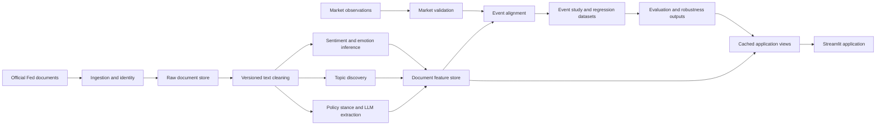

# Phase 2 architecture

## Objective

The project will turn the audited notebook into a reproducible research pipeline and an interactive policy-intelligence application. The architecture keeps source acquisition, validation, NLP inference, event construction, statistical analysis, and presentation separate so each result can be traced to inputs and configuration.

Phase 2 created the shared foundations required by later phases: package metadata,
validated settings, structured logging, environment defaults, and tests. The status
table below has since been updated to describe the completed system while preserving
the original architectural boundaries.

## Design principles

1. Preserve source records and raw text. Cleaning creates new versioned fields rather than overwriting inputs.
2. Treat a document, an announcement event, and a market observation as different entities.
3. Require an explicit tokenizer for every model call.
4. Save full probability distributions and inference metadata, not only winning labels.
5. Make exclusions, deduplication decisions, joins, and event alignment observable through count reports.
6. Use cached intermediate outputs so CPU workflows do not rerun models unnecessarily.
7. Keep a mock LLM path as the default until a provider is selected and evaluated.
8. Add modules only when their behavior and tests are implemented.

## Target data flow

## Package boundaries

The intended package is `fed_policy_intelligence`. Only implemented modules are created in the repository.

| Area | Responsibility | Phase 2 status |
|---|---|---|
| `settings.py` | Load and validate YAML settings, resolve paths, apply narrow environment overrides | Implemented |
| `logging_config.py` | Configure consistent JSON or human-readable process logs | Implemented |
| `data/identity.py` | Canonical URLs, document IDs, content hashes, and file hashes | Implemented in Phase 3 |
| `data/ingestion.py` | Lossless local CSV ingestion and normalized document/market records | Implemented in Phase 3 |
| `data/preprocessing.py` | Versioned conservative text cleaning with removal diagnostics | Implemented in Phase 3 |
| `data/validation.py` | Dataset counts, warnings, errors, and exclusion reporting | Implemented in Phase 3 |
| `data/pipeline.py` | CLI orchestration and atomic processed-output writing | Implemented in Phase 3 |
| `analysis/market_data.py` | Reproducible S&P 500 and Treasury acquisition with provenance | Implemented in Phase 6 |
| `nlp/chunking.py` | Tokenizer-explicit long-document chunking | Implemented in Phase 4 |
| `nlp/transformer.py` | Batched CPU/GPU inference and probability aggregation | Implemented in Phase 4 |
| `nlp/sentiment.py` | FinBERT inference with full probabilities and metadata | Implemented and evaluated as a Phase 4 baseline |
| `nlp/emotion.py` | Emotion inference with its paired tokenizer and complete label space | Implemented; neutral-only evaluation coverage is documented |
| `nlp/topics.py` | LDA baseline and optional embedding-model comparison | Implemented; corpus comparison pending |
| `nlp/policy.py` | Transparent policy-stance baseline with abstention | Implemented in Phase 4 as the historical baseline |
| `nlp/train_policy.py` | Reproducible RoBERTa-base fine-tuning on pinned expert FOMC labels | Implemented and externally evaluated |
| `nlp/document_policy.py` | Sentence-level domain inference and document aggregation | Implemented for all market-eligible statements |
| `analysis/events.py` | Statement-event aggregation, leakage controls, session alignment, and VIX windows | Implemented in Phase 5 |
| `analysis/regression.py` | Frozen baseline/enhanced VIX models, robust inference, diagnostics, and sensitivity analysis | Implemented in Phase 5 |
| `evaluation/` | Reviewed annotation schema, validation, classification metrics, and mismatch reporting | Implemented in Phase 4 |
| `llm/` | Strict structured policy schema, mock/Gemini providers, evidence audit, provenance, usage, and cache | Implemented and bounded evaluation complete; not used for primary prediction |
| `app/` | Streamlit views backed by cached outputs | Implemented and page-tested in Phases 7–8 |

This phased creation policy prevents empty modules and documentation that implies unfinished features are available.

## Core data contracts

Later phases should implement and version these logical records. Storage may begin as validated tabular files and evolve only if a demonstrated need exists.

### Document record

| Field | Purpose |
|---|---|
| `document_id` | Stable project identifier derived from canonical source identity |
| `canonical_url` | Normalized official source URL |
| `content_sha256` | Exact-content identity and audit evidence |
| `document_type` | Statement, transcript, minutes, implementation note, speech, or other |
| `publication_date` | Source publication date |
| `publication_timestamp` | Timezone-aware timestamp when verified; otherwise null |
| `timing_precision` | Timestamp, date-only, or unknown |
| `raw_text` | Immutable extracted source text |
| `cleaned_text` | Text created by a named preprocessing version |
| `retrieved_at` | Source retrieval timestamp |
| `processing_version` | Code/config version used for the derived record |

### Prediction record

Every prediction links to `document_id` and records model identifier/revision, tokenizer identifier, preprocessing version, chunking configuration, aggregation method, full class probabilities, derived score, run timestamp, and runtime device.

### Market observation

Market data remains separate from documents and records instrument/series, provider, trading date, timestamp when available, raw level, derived change or return, retrieval date, and transformation version.

### Event record

An event links one or more documents to a documented trading session. It records the alignment rule, timing precision, ambiguity flag, overlapping-event information, and predefined outcome windows. Same-date documents are never silently discarded.

### LLM extraction record

The LLM layer stores schema version, provider/model, prompt version, source passage
identity, structured fields, verbatim evidence, evidence-verification results,
abstentions, errors, token usage, and generation metadata. The deterministic mock,
cache, and Gemini provider are implemented; live-model acceptance remains deferred until
evaluated.

## Configuration strategy

`config/config.yaml` is the versioned default. Environment variables are restricted to machine/runtime selections:

- `FPI_CONFIG_PATH`
- `FPI_DEVICE`
- `FPI_LOG_LEVEL`
- `FPI_LLM_PROVIDER`
- `FPI_LLM_MODEL`
- `GEMINI_API_KEY` (secret; local environment only)

The default device is `cpu` and the default LLM provider is `mock`. Colab can set `FPI_DEVICE=cuda` after GPU dependencies and compatibility are verified. Gemini credentials are supplied only through the local `GEMINI_API_KEY` environment variable and are never stored in project configuration.

## Dependency strategy

`pyproject.toml` is the single dependency source. The lightweight `dev` extra contains
the complete test runtime, including scikit-learn for the LDA test. NLP, training,
analysis, market-data, application, topic-comparison, and LLM capabilities remain
separate optional groups. PyTorch is constrained to `>=2.8,<2.9` because the tested
Windows host encountered a reproducible `c10.dll` initialization failure with later
wheels. The verified NVIDIA environment uses `torch 2.8.0+cu128`; its GPU wheel must
be installed from the official PyTorch index before project extras.

## Local and Colab execution

- Local development targets Python 3.11 or 3.12 and CPU by default. The tested optional Windows GPU path is documented in `docs/windows_gpu_setup.md`.
- Model inference will use configurable batches and persistent caches suitable for a small CPU demonstration.
- Colab will use the same package and configuration, changing only device and storage paths where necessary.
- Generated data, caches, weights, and credentials are excluded from Git.

## Delivery sequence after Phase 2

1. Completed: document identity, validation, and safe preprocessing for the existing corpus.
2. Completed: local market-data validation while preserving every existing VIX row.
3. Completed: tokenizer-safe sentiment and emotion inference with cached outputs.
4. Completed: topic discovery, reviewed baseline evaluation, and expert-supervised
   policy stance.
5. Completed: event alignment, cross-market outcomes, nested explanatory models, and
   robustness checks.
6. Completed: bounded Gemini structured-policy evaluation and decision to retain it
   only as an experimental enrichment layer.
7. Completed: tested Streamlit application from cached, validated outputs.

Each step adds its own modules and tests. No later layer should import notebook state or depend on a previous interactive cell execution.

